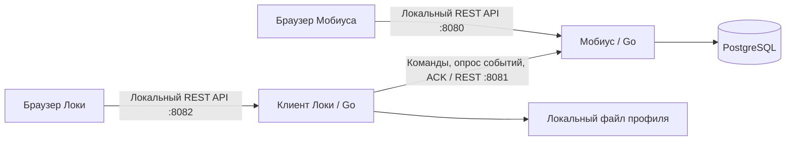

ФИО: Сунцов Сергей Дмитриевич

# Задача №3 от 16.10: Крестики-нолики: Мобиус и Локи

Проект состоит из двух Go-приложений: сервера Мобиуса и клиента Локи. Для каждого игрока запускается отдельный клиент. Сервер хранит данные в PostgreSQL и может вести несколько независимых партий одновременно

Мобиус выбирает Локи, предлагает партию и определяет свою сторону - X или O. Крестики ходят первыми. На принятие или отклонение приглашения отводится 30 секунд. У одного Локи может быть только одно ожидающее приглашение или одна активная партия

В обоих интерфейсах доступны доска и история ходов. Мобиус переключается между активными партиями и просматривает завершённые игры выбранного Локи

При первом подключении Локи регистрируется и получает токен. Клиент сохраняет его в профиле для выбранного адреса сервера и использует при повторном подключении. Имя зарегистрированного Локи не меняется. Токен не передаётся браузеру, данные остальных Локи клиенту недоступны

Браузеры обращаются к локальным REST API своих приложений. Go-клиент раз в секунду запрашивает состояние и события сервера, применяет изменения и подтверждает доставку ходов Мобиуса через ACK. Повтор команды с прежним идентификатором не создаёт второй ход или результат. В PostgreSQL хранятся личности, приглашения, партии, ходы и очередь событий

При отключении Локи или отсутствии его запросов 30 секунд незаконченная партия удаляется и не учитывается в статистике. Перезапуск Мобиуса также удаляет активные партии и отменяет ожидающие приглашения. Завершённые партии и зарегистрированные личности сохраняются

Статистика содержит победы, ничьи и поражения только в завершённых партиях. Доля побед равна числу побед, делённому на число завершённых игр. Для сравнения берутся остальные зарегистрированные Локи с завершёнными играми, включая отключённых; равные доли не считаются превосходством. Новички получают приветствие. Если других сыгравших Локи нет, сравнительная надпись отсутствует

Если Локи превосходит ровно половину остальных, отображается «Вы бейзлайн». Если больше половины - «Вы лучше N %», где N - доля игроков с меньшей долей побед. Иначе сообщение «Вы хуже N %» показывает долю игроков с большей долей побед. Порог проверяется до округления, процент в тексте округляется до целого. Приглашение сохраняет снимок статистики на момент отправки

## Архитектура

По умолчанию интерфейсы доступны на `http://127.0.0.1:8080` и `http://127.0.0.1:8082`, API сервера для клиентов - на порту `8081`. В Compose используется сеть хоста; PostgreSQL доступен с хоста на `127.0.0.1:54320`. Для дополнительных клиентов нужны отдельные порты интерфейса и каталоги профиля.

## Makefile

| Таргет | Что делает |
|---|---|
| `make build` | Собирает бинарники `bin/mobius` и `bin/loki` |
| `make fmt` | Форматирует Go код` |
| `make test` | Запускает `go vet`, Go тесты с интеграционными сценариями и `-race`, затем JS тесты. Нужны Node.js и `TEST_DATABASE_URL` отдельной пустой PostgreSQL |
| `make up` | Собирает образы, запускает PostgreSQL, применяет миграции и поднимает приложения с проверкой готовности |
| `make down` | Останавливает и удаляет контейнеры, сохраняя тома БД и профилей |
| `make reup` | Выполняет `down` затем `up` |
| `make db-clear` | Останавливает установку и удаляет тома БД и клиентских профилей текущего Compose проекта. Следующий `up` даёт чистый старт |

Для проверки остановки и восстановления БД в `make test` можно дополнительно задать `TEST_POSTGRES_CONTAINER`: имя временного контейнера PostgreSQL, обслуживающего `TEST_DATABASE_URL`. Этот контейнер тест остановит и запустит заново

---
